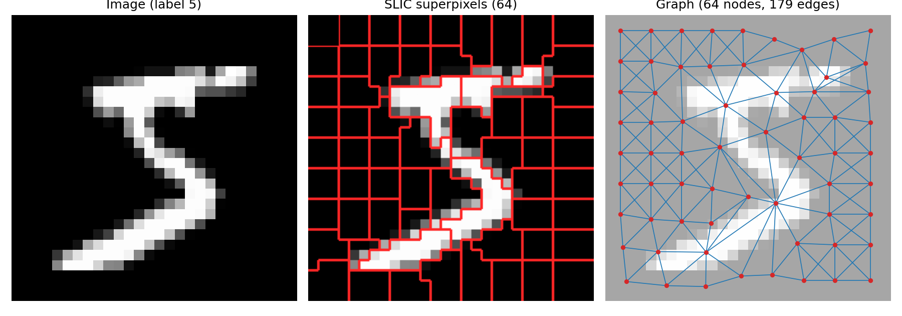
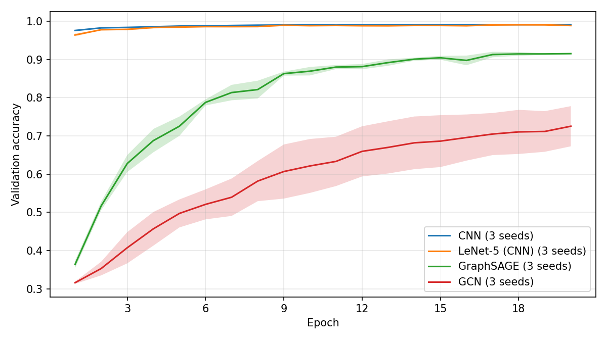
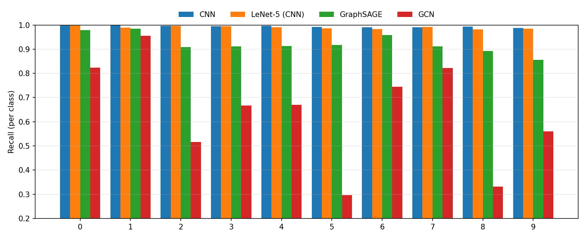

# Image classification with graph neural networks on superpixel graphs

Each MNIST image is turned into a graph of superpixels and classified by a graph neural network
(GCN or GraphSAGE, PyTorch Geometric). The graph models are compared with two CNNs on the raw pixels:
LeNet-5, which has about as many parameters as GraphSAGE, and a CNN seven times larger.

Author: Axel Belloir. Final-year project, Galatasaray University (INF494, June 2026). The code was restructured and the
MNIST experiments were re-run in November 2026 with a validation-based protocol; the report
(`report/rapport.pdf`, in French) describes the method and the results.



## Results (MNIST)

Same settings for every model, best epoch chosen on the validation set, test set evaluated once per run.
Mean ± standard deviation over three seeds (0, 1, 2).

| Model | Input | Parameters | Validation accuracy (%) | Test accuracy (%) | Best epoch (mean) |
|---|---|---:|---:|---:|---:|
| GCN | graph, 5 features | 34,122 | 72.53 ± 6.44 | 72.39 ± 6.68 | 20.0 |
| GraphSAGE | graph, 5 features | 59,018 | 91.77 ± 0.28 | **92.29 ± 0.17** | 19.0 |
| LeNet-5 | pixels | 61,706 | 99.07 ± 0.01 | 99.10 ± 0.10 | 17.7 |
| CNN | pixels | 421,642 | 99.16 ± 0.02 | 99.31 ± 0.08 | 15.7 |

Ablations, same settings and seeds:

| Model | Node features | Validation accuracy (%) | Test accuracy (%) |
|---|---|---:|---:|
| GraphSAGE | 5, standardised | 91.77 ± 0.28 | 92.29 ± 0.17 |
| GraphSAGE | 5, not standardised | 75.21 ± 2.71 | 75.76 ± 2.86 |
| GCN | 5, standardised | 72.53 ± 6.44 | 72.39 ± 6.68 |
| GCN | 3, standardised | 62.49 ± 3.30 | 63.04 ± 3.29 |

Full per-run details: `results/summary.md`, `results/mnist/*.json` and the training log `results/run_all.log`.

| Validation accuracy per epoch | Recall per class |
|---|---|
|  |  |

- GraphSAGE is far ahead of GCN under identical conditions: GCN averages each node with its neighbours using
  shared weights, so a node's own features get diluted; GraphSAGE keeps separate weights for the node itself.
- The CNNs stay ahead even at an equal parameter budget (LeNet-5): the superpixel graph summarises the image,
  and global mean pooling gives the background as much weight as the strokes.
- The graph models do not overfit (train accuracy in eval mode ≈ test accuracy) but learn much more slowly;
  GCN is still gaining 0.5 to 1.2 points per epoch at the end, so 20 epochs underestimates it.
- GCN is unstable across seeds (64.67% to 76.35% test accuracy); GraphSAGE is not (92.09% to 92.39%).
- Feature standardisation matters: without it GraphSAGE drops from 92.29% to 75.76% and learns more slowly
  (about 46% validation accuracy after 6 epochs, against 79% with it).
- With 3 features instead of 5, GCN loses about 9 points on average (63.04% against 72.39%), but the ranges
  over seeds overlap: a trend, not a firm conclusion.
- Not re-run with this protocol: CIFAR-10.

## Method

**Image to graph** (`src/graphs.py`)

1. SLIC segments the image into about 75 superpixels (`n_segments=75`, compactness 0.1 for
   intensities in [0, 1]). On MNIST this gives 65.7 superpixels per image on average (52 to 81), with 189 edges (mean degree 5.75).
2. Each superpixel becomes a node with 5 features:

   | Feature | Meaning |
   |---|---|
   | `mean_intensity` | mean intensity of the superpixel |
   | `x`, `y` | centroid, divided by the image width and height |
   | `area` | fraction of the image covered |
   | `std_intensity` | standard deviation of the intensity (texture) |

   The features are standardised (zero mean, unit variance) with statistics of the training graphs only,
   because their raw scales differ a lot (the standard deviation of `area` is about 0.005).
3. Two superpixels that touch (8-neighbourhood) are joined by an edge in both directions. This is the
   region adjacency graph of scikit-image (`rag_mean_color`, connectivity 2), computed with numpy;
   all 70,000 graphs are built in a few minutes on 2 cores and cached in `data/graphs/`.

**Models** (`src/models.py`)

| Model | Input | Architecture | Parameters |
|---|---|---|---:|
| GCN | graph | 3 × GCNConv (5→64→128→128), global mean pooling, MLP 128→64→10 | 34,122 |
| GraphSAGE | graph | 3 × SAGEConv (same sizes), global mean pooling, MLP 128→64→10 | 59,018 |
| LeNet-5 | pixels | 2 conv 5×5 + 3 dense layers | 61,706 |
| CNN | pixels | 2 conv 3×3 (32, 64) + dense 3136→128→10 | 421,642 |

## Evaluation protocol

- The 60,000 training images are split once into 55,000 for training and 5,000 for validation
  (same split for every model and seed). The 10,000 test images are never used for any choice.
- Same settings for every model: Adam (learning rate 1e-3, weight decay 1e-4), batch size 64,
  20 epochs, learning rate halved every 8 epochs.
- The weights kept are those of the epoch with the best **validation** accuracy; the test set is
  evaluated once, with those weights.
- Every configuration is trained with seeds 0, 1 and 2; results are mean ± standard deviation (n = 3).
- Ablations with the same settings: GCN with 3 features (`mean_intensity`, `x`, `y`) against 5,
  and GraphSAGE without feature standardisation.

## Reproduce

```bash
git clone https://github.com/akselDang/INF494_projet.git && cd INF494_projet
pip install -r requirements.txt   # install PyTorch first if needed: https://pytorch.org/get-started/locally/
bash run_all.sh                   # all MNIST experiments, 3 seeds each (Windows: .\run_all.ps1)
```

or step by step:

```bash
python -m src.train --dataset mnist --model sage --seed 0
python -m src.train --dataset mnist --model gcn --features 3 --seed 0
python -m src.train --dataset mnist --model sage --raw-features --seed 0
python -m src.summarize                                   # table in results/summary.md
python -m src.visualize --dataset mnist --models cnn lenet sage gcn --seed 0
python -m src.demo_pipeline --stats                       # pipeline figure, graph statistics
```

The reported runs used a Colab T4 GPU (PyTorch 2.14.1, PyTorch Geometric 2.8.1): about 9 s per epoch for the
graph models and 3 s for the CNNs, under an hour for everything (`colab.ipynb`). On a 2-core CPU, one epoch of a
graph model takes from 30 s to several minutes. Each run writes `results/mnist/<run>.json`
(configuration, per-epoch history, best epoch, validation and test accuracy, library versions)
and the test predictions; the best weights go to `checkpoints/`.

## Repository structure

```
src/
  graphs.py         image -> superpixel graph, cache
  data.py           MNIST / CIFAR-10 loading, fixed train / validation split
  models.py         GCN, GraphSAGE, LeNet-5, CNNs
  train.py          training, validation-based model selection, one test evaluation
  summarize.py      results table over seeds
  visualize.py      confusion matrices, recall per class, learning curves, errors
  demo_pipeline.py  pipeline figure and graph statistics
results/            one JSON file per run, summary.md, run_all.log
figures/            figures of the report
report/             report (LaTeX source and PDF, in French) and make_numbers.py
run_all.sh / run_all.ps1, colab.ipynb
```

## Notes and limitations

- The superpixel graphs are built here; they are not the MNIST-75 dataset of Monti et al. (2017) nor the
  graphs of Dwivedi et al. (2023), so accuracies are not directly comparable with published results.
- 20 epochs is a small budget, first chosen for CPU runs: the validation curves show that GCN has not converged.
- Three seeds give only a rough estimate of the standard deviation.
- CIFAR-10 is supported by the code (`--dataset cifar10`) but was not re-run with this protocol.
- On GPU, some PyTorch Geometric operations are not bit-for-bit deterministic.

## References

- Achanta et al., *SLIC superpixels compared to state-of-the-art superpixel methods*, IEEE TPAMI, 2012.
- Kipf & Welling, *Semi-supervised classification with graph convolutional networks*, ICLR 2017.
- Hamilton, Ying & Leskovec, *Inductive representation learning on large graphs*, NeurIPS 2017.
- Monti et al., *Geometric deep learning on graphs and manifolds using mixture model CNNs*, CVPR 2017.
- Dwivedi et al., *Benchmarking graph neural networks*, JMLR 2023.
- Fey & Lenssen, *Fast graph representation learning with PyTorch Geometric*, ICLR Workshop 2019.
- LeCun et al., *Gradient-based learning applied to document recognition*, Proc. IEEE, 1998.
